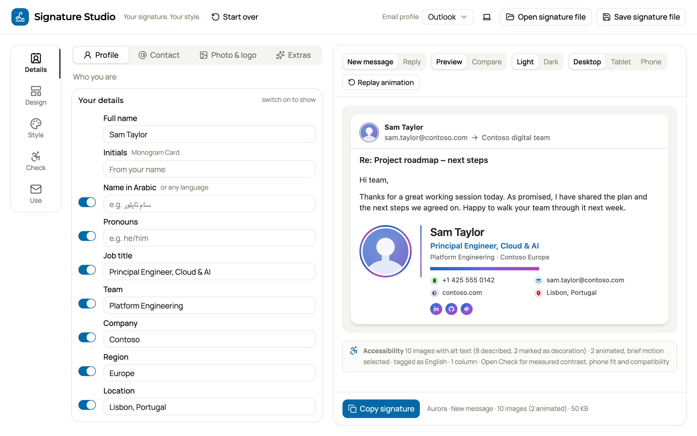

# Signature Studio

Make an email signature that looks right in Outlook, with checks for accessibility and phone fit.

Add your details, pick a design, adjust the style, check it and copy it into your email app. Everything runs in your browser. Nothing is uploaded.

**[Open Signature Studio](https://signature-studio.amgdy.com/)**

[](https://github.com/amgdy/signature-studio/actions/workflows/ci.yml)
[](LICENSE)



The Executive design, with a handwritten name and an animated photo ring:


## Features

- **36 designs**, including 12 for industries such as finance, legal, healthcare and education.
- **1, 2 or 3 columns** in every design, and a fit on a 343 px phone.
- **Your photo and logo**, with 15 shapes, 4 sizes, 4 looks and animations that stop within 5 seconds.
- **33 colour palettes** you can edit, local fonts, 17 icon styles and 10 handwriting styles.
- **6 short reply versions.**
- **19 health checks** for each version: accessibility, images, animation, phone fit and Outlook paste survival.
- **Compare** designs and styles side by side, and save your own styles.
- **One signature file** (`.signature.yaml`) with your details, style and images.
- **Copy** to Outlook, as plain text or HTML, or as a classic Outlook package.

See [docs/FEATURES.md](docs/FEATURES.md) for every feature.

## Add it to Outlook

1. Select **Copy signature**.
2. Paste it into Outlook:
   - **New Outlook and Outlook on the web:** Settings > Accounts > Signatures > New signature.
   - **Classic Outlook for Windows:** File > Options > Mail > Signatures. Or extract **Classic Outlook (.zip)** into `%APPDATA%\Microsoft\Signatures`.
   - **Outlook for Mac:** Settings > Signatures.
3. Select **Copy reply signature** and save it as your reply signature.

Send yourself a test before you use a new signature.

## Develop

You need Node 24.11 or later and pnpm (run `corepack enable` once).

```bash
pnpm install
pnpm dev      # the Studio at http://localhost:5173
pnpm build    # apps/studio/dist/index.html, one file that also opens from disk
pnpm check    # format, lint, type check, unit and golden tests
```

See [docs/DEVELOPMENT.md](docs/DEVELOPMENT.md) for the code layout, the Outlook rules, tests, debugging and publishing.

## Contributing

Issues and pull requests are welcome. Read [CONTRIBUTING.md](CONTRIBUTING.md) first. To report a security problem, follow [SECURITY.md](SECURITY.md).

## License

[MIT](LICENSE). The handwriting styles use the SIL Open Font License 1.1. Icons include original drawings and MIT and CC BY 4.0 sets. See [THIRD_PARTY_NOTICES.md](THIRD_PARTY_NOTICES.md).

Microsoft, Outlook, Teams, LinkedIn and GitHub are trademarks of their owners. This project is not affiliated with or endorsed by them.
